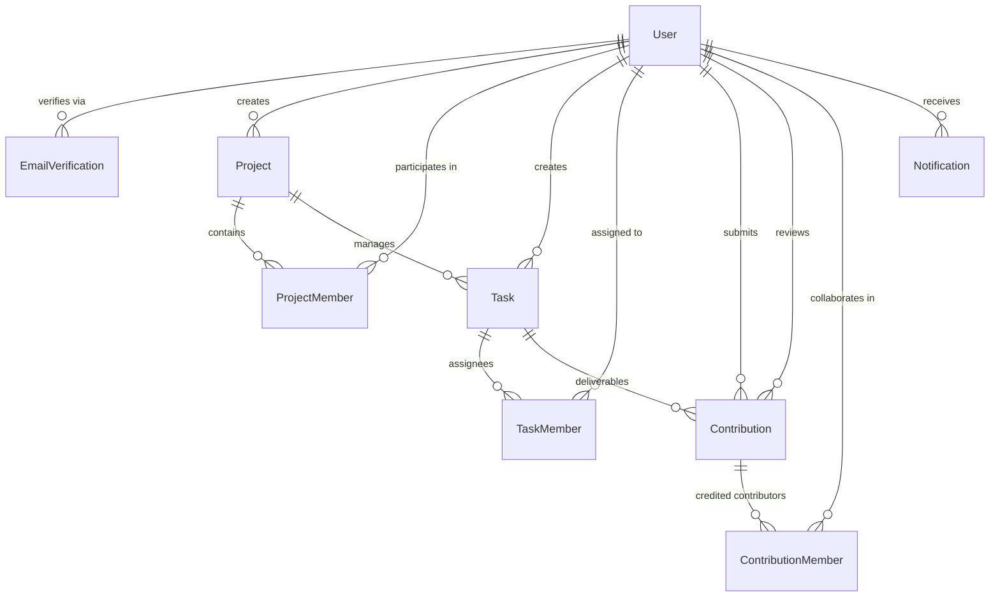

# ContriFlow — Club Contribution Tracker

ContriFlow is a modern, project-centric collaboration and contribution tracking platform designed specifically for student clubs, hackathon teams, and developer communities. 

Unlike traditional project management tools that simply mark tasks as "done", ContriFlow establishes a **verified, evidence-backed record of member contributions**, complete with peer/lead review workflows, AI-assisted task breakdown, automated activity logs, and real-time notifications.

---

## 📌 Problem & Solution

### The Problem
* **Invisible Contributions:** Hard-working team members contributing to design, research, outreach, or documentation often go unacknowledged because traditional tools only capture code commits.
* **Lack of Proof & Accountability:** Tasks are marked complete without attached evidence, making it difficult for leads to verify authenticity.
* **Fragmented Coordination:** Updates and discussion get lost across WhatsApp, Discord, Google Docs, and spreadsheets.
* **Leadership Transition Challenges:** Historical records disappear when club leadership graduates or transitions.

### The Solution
* **Verified Evidence Submissions:** Contributors attach URLs and documentation proofs when submitting completed tasks.
* **Structured Lead Review Workflow:** Project Leads review submissions, approve or reject work, and provide actionable feedback.
* **Google Gemini AI Task Generator:** Leads can instantly decompose complex project goals into 5 actionable, practical deliverables with one click.
* **Secure Gmail OTP Verification:** Password-protected registration enforced with 6-digit cryptographic email verification codes and rate limiting.
* **Live Notifications & Activity Feeds:** Instant in-app alerts and project-wide audit logs keeping teams aligned.

---

## 🚀 Key Features

* **🔐 Secure Authentication & Verification:**
  * Gmail-validated registration requiring 6-digit one-time passwords (OTP) sent via Brevo.
  * Resend OTP with 60-second cooldown rate-limiting and 5-attempt brute-force protection.
  * JWT session handling with bcrypt password hashing.

* **📁 Project & Workspace Management:**
  * Role-based access control with `LEAD` and `MEMBER` privileges.
  * Unique 6-character project invite codes with lead regeneration capabilities.
  * Team member role promotion/demotion and self-serve project leave options.

* **📋 Task Management & AI Generation:**
  * Task status tracking (`TODO`, `IN_PROGRESS`, `DONE`) with deadlines.
  * Multiple assignees per task with distinct task roles.
  * **AI Task Generator:** Powered by Google Gemini (`gemini-2.5-flash-lite`) to generate 5 structured, contextual tasks directly into the project board.

* **🏆 Evidence-Backed Contribution Tracking:**
  * Contributors submit proof links, titles, and descriptions upon completing tasks.
  * Multi-contributor support for collaborative deliverables.
  * Formal lead approval workflow (`PENDING`, `APPROVED`, `REJECTED`) with contextual feedback.

* **🔔 In-App Notifications & Audit Trail:**
  * Bell dropdown with unread badge counters.
  * Automatic notifications triggered on task assignment, review approval, rejection feedback, and team updates.
  * Chronological project activity feed displaying recent actions.

* **📊 Member Statistics & Dashboard:**
  * Project overview metrics (total tasks, completed deliverables, pending reviews).
  * Member leaderboard detailing approved tasks, pending submissions, and completion rates.

* **👤 Contributor Profile:**
  * Personal portfolio view summarizing all verified contributions across projects.

---

## 🛠️ Tech Stack

### Frontend
* **Framework:** React 19 with TypeScript
* **Build Tool:** Vite
* **Styling:** Tailwind CSS v4
* **UI Components:** Radix UI primitives & Lucide React icons
* **Forms & Validation:** React Hook Form & Zod
* **HTTP Client:** Axios (configured with automatic JWT authorization interceptors)
* **Feedback & Toasts:** Sonner
* **Routing:** React Router v7

### Backend
* **Runtime & Framework:** Node.js & Express.js
* **ORM:** Prisma ORM
* **Database:** PostgreSQL
* **Authentication:** JSON Web Tokens (JWT) & bcryptjs
* **Email Service:** Brevo (Sendinblue) Transactional Email API
* **AI Integration:** Google Gemini API (`gemini-2.5-flash-lite`)

---

## 📁 Repository Structure

```text
club-contribution-tracker/
├── client/                          # React + TypeScript Frontend
│   ├── src/
│   │   ├── components/
│   │   │   ├── common/              # Global components & Brand Logo
│   │   │   ├── contribution/        # Contribution submission dialogs
│   │   │   ├── layout/              # App layout, Header, Notifications dropdown
│   │   │   ├── project/             # Project creation, editing & join dialogs
│   │   │   ├── task/                # Task creation, assignment & AI generator dialogs
│   │   │   └── ui/                  # Radix UI primitives (Button, Card, Dialog, etc.)
│   │   ├── context/                 # AuthContext & ThemeContext
│   │   ├── lib/                     # Zod validation schemas & Axios client
│   │   ├── pages/                   # Application views
│   │   │   ├── auth/                # Login & Signup with OTP verification
│   │   │   ├── contribution/        # Contribution detail and review view
│   │   │   ├── dashboard/           # Project analytics & member leaderboards
│   │   │   ├── landing/             # Marketing landing page
│   │   │   ├── profile/             # User profile & verified portfolio
│   │   │   ├── project/             # Project listing, details, activity & settings
│   │   │   └── task/                # Task detail & submissions
│   │   ├── routes/                  # Protected route wrappers & React Router tree
│   │   └── services/                # Backend API service functions
│   ├── package.json
│   └── vite.config.ts
│
├── server/                          # Express.js REST API Server
│   ├── prisma/
│   │   └── schema.prisma            # Prisma schema models & PostgreSQL relations
│   ├── src/
│   │   ├── controllers/             # Endpoint controllers (auth, ai, project, task, etc.)
│   │   ├── lib/                     # Prisma client singleton
│   │   ├── middleware/              # JWT auth and permission verification
│   │   ├── routes/                  # Express route definitions
│   │   ├── services/                # Email dispatch & business logic
│   │   ├── utils/                   # OTP generator, project RBAC helpers, notifications
│   │   └── app.js                   # Express application entry point
│   ├── scripts/                     # Smoke tests & database health checks
│   ├── package.json
│   └── .env                         # Server environment variables
│
└── README.md                        # Master Project Documentation
```

---

## 🗄️ Database Architecture

The PostgreSQL database is defined and migrated via Prisma ORM:



### Models Summary

| Model | Description | Key Attributes / Relations |
| :--- | :--- | :--- |
| **`User`** | Platform user account (student, contributor, lead). | `id`, `name`, `email`, `password`, `createdAt` |
| **`EmailVerification`** | Pending signup verification store with cooldown & expiry tracking. | `email`, `name`, `passwordHash`, `otpHash`, `expiresAt`, `attempts`, `lastSentAt` |
| **`Project`** | Project workspace created and coordinated by leads. | `id`, `name`, `description`, `inviteCode`, `createdById` |
| **`ProjectMember`** | Links users to projects with designated roles. | `userId`, `projectId`, `role` (`LEAD`, `MEMBER`), `joinedAt` |
| **`Task`** | Milestone or task deliverable within a project. | `id`, `title`, `description`, `deadline`, `status` (`TODO`, `IN_PROGRESS`, `DONE`), `projectId` |
| **`TaskMember`** | User assignment mapping for tasks. | `taskId`, `userId`, `roleInTask`, `assignedAt` |
| **`Contribution`** | Work submitted with proof URLs for review. | `id`, `title`, `description`, `proofUrl`, `status` (`PENDING`, `APPROVED`, `REJECTED`), `feedback` |
| **`ContributionMember`** | Maps multiple contributors credited on a single contribution. | `contributionId`, `userId`, `addedAt` |
| **`Notification`** | In-app user notifications for events and reviews. | `id`, `userId`, `message`, `isRead`, `createdAt` |

---

## 🔌 API Reference

### 🔐 Authentication (`/api/auth`)
* `POST /api/auth/signup` — Request a 6-digit OTP to a valid Gmail address.
* `POST /api/auth/verify-otp` — Verify 6-digit OTP and create user account.
* `POST /api/auth/resend-otp` — Request a new OTP (enforces 60s cooldown).
* `POST /api/auth/login` — Authenticate credentials and receive a JWT.
* `GET /me` — Retrieve the currently authenticated user session.

### 🤖 AI Task Generation (`/api/ai`)
* `POST /api/ai/generate-tasks` — Generate 5 actionable project tasks using Google Gemini (Project Lead only).

### 📁 Projects (`/api/projects`)
* `GET /api/projects` — Fetch all projects the authenticated user belongs to.
* `POST /api/projects` — Create a new project workspace.
* `GET /api/projects/:projectId` — Fetch project details, members, and roles.
* `PATCH /api/projects/:projectId` — Update project metadata (Lead only).
* `DELETE /api/projects/:projectId` — Delete a project (Lead only).
* `POST /api/projects/join` — Join a project using an invite code.
* `POST /api/projects/:projectId/leave` — Leave a project.
* `GET /api/projects/:projectId/activity` — Retrieve the project activity audit log.
* `POST /api/projects/:projectId/invite-code` — Regenerate the project invite code (Lead only).
* `POST /api/projects/:projectId/members/:memberId/role` — Update a member's role (`LEAD` / `MEMBER`).
* `GET /api/projects/:projectId/tasks` — Fetch all tasks under a project.

### 📋 Tasks (`/api/tasks`)
* `POST /api/tasks` — Create a new project task (Lead only).
* `GET /api/tasks/:taskId` — Retrieve task details and assignees.
* `PATCH /api/tasks/:taskId` — Update task details, status, or deadline.
* `DELETE /api/tasks/:taskId` — Delete a task (Lead only).
* `POST /api/tasks/:taskId/assign` — Assign a member to a task.
* `DELETE /api/tasks/:taskId/assignees/:userId` — Remove an assignee from a task.

### 🏆 Contributions (`/api/contributions`)
* `POST /api/contributions` — Submit a proof-backed contribution for a task.
* `GET /api/contributions/:contributionId` — Retrieve contribution details.
* `PATCH /api/contributions/:contributionId` — Update contribution details.
* `DELETE /api/contributions/:contributionId` — Delete a contribution.
* `GET /api/contributions/task/:taskId` — Fetch all contributions for a given task.
* `PATCH /api/contributions/:contributionId/review` — Approve or reject a contribution with feedback (Lead only).

### 🔔 Notifications (`/api/notifications`)
* `GET /api/notifications` — Fetch all notifications for the current user.
* `POST /api/notifications/read-all` — Mark all notifications as read.
* `POST /api/notifications/:notificationId/read` — Mark a single notification as read.

### 📊 Dashboard & Analytics (`/api/dashboard`)
* `GET /api/dashboard/:projectId` — Retrieve project-level task counts and status breakdown.
* `GET /api/dashboard/:projectId/members` — Retrieve member-wise contribution stats and leaderboard.

### 👤 Users (`/api/users`)
* `GET /api/users/:userId/profile` — Fetch a user's verified contributions and project statistics.
* `PUT /api/users/:userId/profile` — Update user profile details.

---

## ⚡ Getting Started

### Prerequisites
* **Node.js:** v18.0.0 or higher
* **npm:** v9.0.0 or higher
* **PostgreSQL:** Running locally or a hosted instance (e.g. Supabase, Neon, Railway)
* **Google Gemini API Key:** Free key from [Google AI Studio](https://aistudio.google.com/)
* **Brevo (Sendinblue) API Key:** For sending transactional OTP emails

---

### Step 1: Clone the Repository
```bash
git clone https://github.com/iqbhavya/ContriFlow.git
cd club-contribution-tracker
```

---

### Step 2: Configure the Backend Server

1. Navigate to the server directory:
   ```bash
   cd server
   ```

2. Install dependencies:
   ```bash
   npm install
   ```

3. Create a `.env` file in `server/.env`:
   ```env
   # PostgreSQL Database URL
   DATABASE_URL="postgresql://<user>:<password>@localhost:5432/contriflow?schema=public"

   # JWT Authentication Secret
   JWT_SECRET="your_super_secret_jwt_key_here"

   # Google Gemini API Key for AI Task Generation
   GEMINI_API_KEY="AIzaSy..."

   # Brevo API for OTP Verification
   BREVO_API_KEY="xkeysib-..."
   BREVO_SENDER_EMAIL="your-verified-sender@domain.com"
   ```

4. Run Prisma database migrations & client generation:
   ```bash
   npx prisma migrate dev --name init
   npx prisma generate
   ```

5. Start the backend development server:
   ```bash
   npm run dev
   # or: node src/app.js
   ```
   *Server will run at `http://localhost:3000`.*

---

### Step 3: Configure the Frontend Client

1. Open a new terminal and navigate to the client directory:
   ```bash
   cd client
   ```

2. Install dependencies:
   ```bash
   npm install
   ```

3. Start the Vite development server:
   ```bash
   npm run dev
   ```
   *Frontend will launch at `http://localhost:5173`.*

4. Build for production:
   ```bash
   npm run build
   ```

---

## 🤝 Contributing

Contributions, bug reports, and feature requests are welcome!
1. Fork the project repository.
2. Create your feature branch (`git checkout -b feature/NewFeature`).
3. Commit your changes (`git commit -m "Add NewFeature"`).
4. Push to the branch (`git push origin feature/NewFeature`).
5. Open a Pull Request.

---

## 📝 License

Distributed under the ISC License. See `package.json` for details.

---

## 👨‍💻 Author

**Bhavya Yadav**
* GitHub: [@iqbhavya](https://github.com/iqbhavya)
